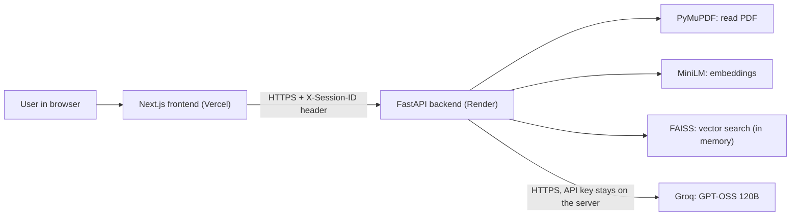
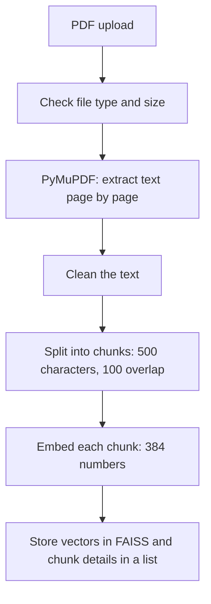
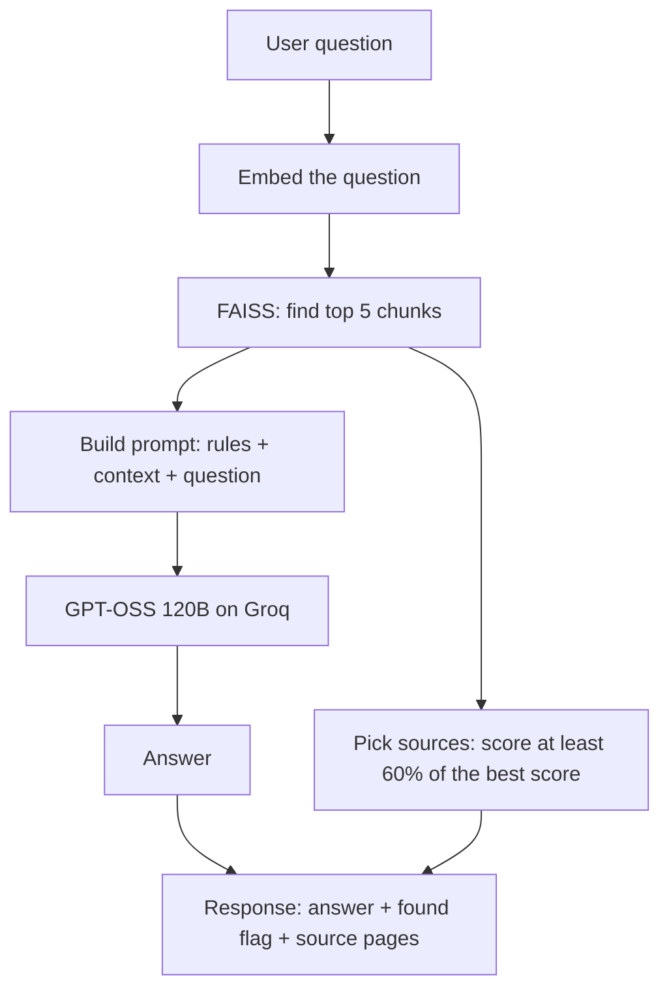

# RAG Chatbot

Upload a PDF, ask questions about it, and get answers that come **only from your document**, with the **source page numbers** shown next to every answer. If the answer is not in the PDF, the chatbot says so instead of inventing one.

**Live demo:** `<add your Vercel link after deployment>`
**GitHub repository:** <https://github.com/Siddhesh842000/RAG-Chatbot>

---

## Table of contents

1. [Overview](#1-overview)
2. [Features](#2-features)
3. [Screenshots](#3-screenshots)
4. [Tech stack](#4-tech-stack)
5. [Architecture](#5-architecture)
6. [RAG workflow, step by step](#6-rag-workflow-step-by-step)
7. [How hallucinations are reduced](#7-how-hallucinations-are-reduced)
8. [Design decisions](#8-design-decisions)
9. [Project structure](#9-project-structure)
10. [Installation](#10-installation)
11. [Environment variables](#11-environment-variables)
12. [Configuration (tunable settings)](#12-configuration-tunable-settings)
13. [API reference](#13-api-reference)
14. [Testing](#14-testing)
15. [Deployment](#15-deployment)
16. [Troubleshooting](#16-troubleshooting)
17. [Limitations](#17-limitations)
18. [Future improvements](#18-future-improvements)
19. [Interview explanation](#19-interview-explanation)
20. [Changelog](#20-changelog)

---

## 1. Overview

**RAG** stands for *Retrieval-Augmented Generation*. Instead of asking a language model to answer from memory, we first **retrieve** the parts of your document that are relevant to the question, then ask the model to **generate** an answer using only those parts.

This project is a complete, end-to-end implementation:

- A **FastAPI** backend that reads PDFs, splits them into chunks, turns the chunks into vectors, stores them in **FAISS**, and asks **GPT-OSS 120B on Groq** to answer.
- A **Next.js** frontend with a clean, responsive chat interface, nicely formatted answers, and a black-and-white theme switcher.
- Careful error handling, tests for every stage, and a design that fits **free hosting** (Render and Vercel).

---

## 2. Features

**Chatbot**

- Upload a text-based PDF (up to 10 MB and 100 pages).
- Ask questions in plain English and get short, clear answers.
- **Formatted answers:** bold text, bullet lists, numbered steps, code and tables are shown properly. Raw HTML inside an answer is never executed, so text hidden in a PDF cannot run code in the page.
- **Source pages** are shown under each answer, with a "View passages" section that shows the exact text used.
- **Honest "not found" answers:** when the document does not contain the answer, the reply is a fixed sentence and no sources are shown.
- **Clear** button removes the document and the conversation.

**Reliability**

- Every error has a clear message and a proper HTTP status code (invalid or corrupted PDF, empty file, scanned PDF, wrong file type, file too large, empty question, missing document, LLM errors).
- If the free server restarts and forgets your document, the app tells you and asks you to upload again.
- If the free server is waking up, the app shows a "taking longer than usual" hint instead of looking frozen.

**Multi-visitor safe**

- Each visitor gets a random session id, so two people using the live demo never see each other's documents.

**Interface**

- Responsive layout: one column on phones and tablets, two columns on large screens.
- **Theme dropdown:** the default look is black and white. The dropdown lets you choose the **mode** (Black or White) and a **color** (Mono, Aurora, Ocean, Emerald, Sunset, Gold). Your choice is remembered.
- Loading indicator, upload status messages, keyboard friendly, no sideways scrolling on small screens.

---

## 3. Screenshots

Add your own screenshots to a `docs/screenshots/` folder and link them here.

| View | Image |
|---|---|
| Home (Black, Mono) | `` |
| Answer with sources | `` |
| "Not found" answer | `` |
| Theme dropdown | `` |
| White mode | `` |
| Phone view | `` |

---

## 4. Tech stack

| Layer | Technology | Why |
|---|---|---|
| Frontend | **Next.js 16**, **React 19**, **Tailwind CSS 4** | Fast, simple to deploy on Vercel |
| Answer formatting | **react-markdown** + **remark-gfm** | Shows bold, lists, code and tables safely (no raw HTML) |
| Backend | **Python**, **FastAPI**, **Uvicorn**, **Pydantic** | Clean typed API with automatic Swagger docs |
| PDF reading | **PyMuPDF** | Fast, reliable text extraction with page numbers |
| Embeddings | **sentence-transformers** `all-MiniLM-L6-v2` (384 numbers per text) | Small, fast, runs on a normal CPU |
| Vector search | **FAISS** (`faiss-cpu`) | Fast similarity search, no database to pay for |
| LLM | **GPT-OSS 120B** (`openai/gpt-oss-120b`) through the **Groq API** | Strong open model, very fast, free tier available |
| Hosting | Frontend on **Vercel**, backend on **Render**, source on **GitHub** | All have free tiers |

No paid LLM API, no GPU and no paid database is needed.

---

## 5. Architecture



Important rule: the **Groq API key exists only on the backend**. The browser never sees it.

---

## 6. RAG workflow, step by step

### Upload flow (`POST /api/upload`)



1. **Validate.** The file must end in `.pdf`, be at most 10 MB, and have at most 100 pages with text.
2. **Extract.** PyMuPDF reads the PDF and returns one item per page: `{"text", "page", "document"}`. Page numbers start at 1.
3. **Clean.** Line wraps become spaces, words split by a hyphen at a line end are joined, extra spaces are removed, and real paragraph breaks are kept.
4. **Chunk.** Each page is split on its own into pieces of at most **500 characters** with **100 characters of overlap**. Splitting happens at sentence boundaries when possible. Because every page is chunked separately, **every chunk keeps exactly one page number**.
5. **Embed.** Each chunk becomes a vector of 384 numbers using `all-MiniLM-L6-v2`. Vectors are normalized, so a dot product equals cosine similarity.
6. **Store.** Vectors go into a FAISS `IndexFlatIP` (exact search). The chunk text, page and document name are kept in a Python list at the same positions.

### Chat flow (`POST /api/chat`)



1. The question is embedded with the same model.
2. FAISS returns the **top 5** most similar chunks, each with a similarity score.
3. The chunks are placed in the prompt, each labelled with its document and page.
4. GPT-OSS 120B writes the answer using only that context.
5. If the answer is the fixed "not found" sentence, `found` is `false` and no sources are returned. Otherwise the response includes sources.
6. Only chunks whose score is at least **60% of the best score** are shown as sources, so weak matches do not clutter the answer. (The model still reads all 5 chunks.)

The prompt follows this shape:

```text
Context:
[Source: report.pdf, page 4]
...chunk text...
---
[Source: report.pdf, page 9]
...chunk text...

Question:
<the user's question>

Answer:
```

---

## 7. How hallucinations are reduced

Hallucination means the model states something that is not in the document. Several layers work together:

1. **Strict system prompt.** The model must use only the context, must not guess or use outside knowledge, and must keep answers short.
2. **Fixed "not found" sentence.** When the context has no answer, the model must reply exactly: *"I could not find this information in the document."* The backend recognizes this sentence and treats it as "not found".
3. **Low temperature (0.1).** Answers are stable and factual instead of creative.
4. **No chunks, no LLM call.** If nothing is retrieved, the backend returns the "not found" sentence directly.
5. **Prompt-injection protection.** The prompt tells the model that the document text is data, not instructions. A PDF containing "ignore all previous instructions" does not take over the chatbot (this is tested).
6. **Honest sources.** Source pages are hidden when the answer is "not found", so the user never sees page numbers attached to a refusal.
7. **Tested behavior.** Tests ask questions that are not in the document (for example "What is the capital of France?") and check that the answer is the fixed sentence.

---

## 8. Design decisions

| Decision | Reason |
|---|---|
| **Chunk size 500 characters, overlap 100** | About one short paragraph per chunk keeps each vector focused on one idea. Overlap stops an answer from being cut in half at a boundary. |
| **Top-K = 5** | About 2,500 characters of context: enough to answer most questions, small enough to be fast and cheap. |
| **Chunk each page separately** | Guarantees one page number per chunk, which makes source pages exact. A sentence that runs across a page break is split there. |
| **Exact search (`IndexFlatIP`)** | A single PDF has hundreds of chunks, so exact search is instant and has no approximation error. |
| **Embedding model loaded once** | Loading takes seconds. It is loaded in the background at startup and reused for every request. |
| **FAISS index kept in memory** | Render's free filesystem is erased on restart, so saving files would add code for little benefit. The trade-off is that the document must be uploaded again after a restart. |
| **One index per visitor (session id)** | Prevents two visitors overwriting each other on the live demo. Only the 5 newest sessions are kept to protect memory. |
| **Upload limits (10 MB, 100 pages)** | Protects the small free server from slow or huge jobs. |
| **All network calls in one frontend file (`lib/api.js`)** | The screens never talk to the server directly, which keeps them simple and easy to test. |
| **Groq key only on the backend** | Keys in browser code can be stolen by anyone. |
| **Markdown without raw HTML** | The AI writes Markdown (bold, lists). Showing it as real formatting is easier to read, and blocking HTML keeps the page safe from content hidden in a PDF. |

---

## 9. Project structure

```text
RAG Chatbot/
├── README.md
├── .gitignore
│
├── backend/
│   ├── app/
│   │   ├── __init__.py
│   │   ├── main.py                 # FastAPI app, CORS, startup, routes
│   │   ├── config.py               # all settings in one place
│   │   ├── schemas.py              # Pydantic request/response models
│   │   ├── routes/
│   │   │   ├── upload.py           # POST /api/upload
│   │   │   └── chat.py             # POST /api/chat, POST /api/clear
│   │   ├── services/
│   │   │   ├── pdf_service.py      # PyMuPDF extraction + text cleaning + PDF errors
│   │   │   ├── chunk_service.py    # sentence-aware chunking with overlap
│   │   │   ├── embedding_service.py# MiniLM model (loaded once) + embedding helpers
│   │   │   ├── vector_service.py   # FAISS store, one per session
│   │   │   └── llm_service.py      # Groq client + error mapping
│   │   └── utils/
│   │       ├── prompts.py          # RAG prompt and the "not found" sentence
│   │       └── session.py          # reads the X-Session-ID header
│   ├── test_pdf.py                 # Phase 2 tests
│   ├── test_chunking.py            # Phase 3 tests
│   ├── test_embeddings.py          # Phase 4 tests
│   ├── test_faiss.py               # Phase 5 tests
│   ├── test_llm.py                 # Phase 6 tests (needs Groq key)
│   ├── test_api.py                 # Phase 7 tests of the full API (needs Groq key)
│   ├── requirements.txt
│   ├── download_model.py           # downloads the embedding model during the Render build
│   ├── run.bat                     # Windows launcher you create yourself (not committed)
│   ├── .env.example                # template, safe to commit
│   └── .env                        # your real key, NEVER committed
│
└── frontend/
    ├── app/
    │   ├── page.jsx                # main page and state
    │   ├── layout.jsx              # page shell, theme script
    │   ├── globals.css             # Tailwind + theme colors
    │   └── icon.svg                # favicon
    ├── components/
    │   ├── Upload.jsx              # file picker, upload button, status
    │   ├── Chat.jsx                # messages, loading dots, input, Clear
    │   ├── Message.jsx             # one user/assistant message
    │   ├── Sources.jsx             # source page chips + passages
    │   ├── Markdown.jsx            # formats the AI's answer (bold, lists, code, tables)
    │   └── ThemePicker.jsx         # theme dropdown (mode + color)
    ├── lib/
    │   ├── api.js                  # the only file that calls the backend
    │   ├── session.js              # visitor session id
    │   ├── hooks.js                # "server is slow" hint
    │   └── theme.js                # theme list and saving
    ├── package.json
    ├── postcss.config.mjs
    ├── next.config.mjs
    ├── jsconfig.json
    ├── eslint.config.mjs
    ├── .env.example                # template, safe to commit
    └── .env.local                  # NEXT_PUBLIC_API_URL (not committed)
```

---

## 10. Installation

### Prerequisites

- **Python 3.10 to 3.13** (developed on 3.13.9)
- **Node.js 20.9 or newer** and npm
- **Git**
- A free **Groq API key** from <https://console.groq.com/keys> (starts with `gsk_`)

### Get the code

```cmd
git clone https://github.com/Siddhesh842000/RAG-Chatbot.git
cd RAG-Chatbot
```

### Backend setup (Windows CMD)

```cmd
cd backend
python -m venv venv
venv\Scripts\activate.bat
pip install -r requirements.txt
copy .env.example .env
```

Open `backend\.env` and put your real key after `GROQ_API_KEY=`.

Start the backend:

```cmd
venv\Scripts\python.exe -m uvicorn app.main:app --reload
```

Wait for `Application startup complete`. The first start downloads the embedding model (about 90 MB), so it can take a few minutes. Open <http://127.0.0.1:8000/docs> to see the interactive API page.

> **Always start the backend with `venv\Scripts\python.exe -m uvicorn ...`.** If you have Anaconda installed, a plain `uvicorn` command may use Anaconda's Python, which does not have the project's packages (you will see `No module named 'faiss'`).

To avoid typing it each time, create a small launcher once. It is not committed to Git:

```cmd
echo @echo off> run.bat
echo venv\Scripts\python.exe -m uvicorn app.main:app --reload>> run.bat
```

From then on, start the backend by typing `run.bat` inside the `backend` folder.

On macOS or Linux:

```bash
cd backend
python3 -m venv venv
source venv/bin/activate
pip install -r requirements.txt
cp .env.example .env
python -m uvicorn app.main:app --reload
```

### Frontend setup

Open a **second** terminal and run everything inside the `frontend` folder (the one that contains `package.json`):

```cmd
cd frontend
npm install
```

Create your local settings file from the template:

```cmd
copy .env.example .env.local
```

It contains this single line (change it only if your backend runs somewhere else):

```env
NEXT_PUBLIC_API_URL=http://localhost:8000
```

Start the frontend:

```cmd
npm run dev
```

Open **<http://localhost:3000>**. Use `localhost` exactly. The backend only accepts requests from `http://localhost:3000` by default, so `127.0.0.1:3000` or a network address would be blocked by CORS.

### Try it

1. Upload a text-based PDF.
2. Ask a question about it.
3. Check the answer and the source pages.
4. Ask something that is not in the PDF and confirm you get the "not found" answer.

---

## 11. Environment variables

### Backend (`backend/.env`)

| Variable | Required | Default | Meaning |
|---|---|---|---|
| `GROQ_API_KEY` | **Yes** | none | Your Groq key. Keep it secret. |
| `GROQ_MODEL` | No | `openai/gpt-oss-120b` | The Groq model name. |
| `ALLOWED_ORIGINS` | No | `http://localhost:3000` | Websites allowed to call the API (CORS). Use commas for several, for example `http://localhost:3000,https://your-app.vercel.app`. |
| `MODEL_CACHE_DIR` | No | empty | Folder (relative to `backend/`) where the embedding model is stored. Empty uses the normal Hugging Face cache. Used on Render. |

### Frontend (`frontend/.env.local`)

| Variable | Required | Example | Meaning |
|---|---|---|---|
| `NEXT_PUBLIC_API_URL` | **Yes** | `http://localhost:8000` | Address of the backend. In production this is your Render URL. |

Variables that start with `NEXT_PUBLIC_` are visible in the browser, so **never** put a secret in them.

---

## 12. Configuration (tunable settings)

These live in `backend/app/config.py`.

| Setting | Value | Meaning |
|---|---|---|
| `CHUNK_SIZE` | 500 | Maximum characters per chunk |
| `CHUNK_OVERLAP` | 100 | Characters repeated between neighboring chunks |
| `TOP_K` | 5 | Chunks sent to the LLM |
| `SOURCE_SCORE_RATIO` | 0.6 | A chunk is shown as a source only if its score is at least this fraction of the best score |
| `MAX_FILE_SIZE_MB` | 10 | Largest allowed upload |
| `MAX_PAGES` | 100 | Most pages with text allowed |
| `MAX_SESSIONS` | 5 | Visitors' documents kept in memory at once |
| `EMBEDDING_MODEL` | `sentence-transformers/all-MiniLM-L6-v2` | Embedding model |
| `LLM_TEMPERATURE` | 0.1 | Low means factual and stable |
| `LLM_MAX_TOKENS` | 1500 | Output limit (the model's thinking tokens count too) |
| `LLM_REASONING_EFFORT` | `low` | Faster, cheaper answers |
| `LLM_TIMEOUT_SECONDS` | 30 | Wait time for Groq |

---

## 13. API reference

Base URL (local): `http://localhost:8000`. Interactive docs: `/docs` (Swagger).

All `/api/*` endpoints accept an optional header **`X-Session-ID`** (1 to 64 letters, numbers, `-` or `_`). It separates visitors. Without it, the session `default` is used. The frontend creates one random id per browser.

### `GET /`

```json
{"message": "RAG Chatbot API is running", "docs": "/docs"}
```

### `GET /health`

Used by Render to check that the server is alive.

```json
{"status": "ok", "app": "RAG Chatbot", "version": "0.1.0"}
```

### `POST /api/upload`

Upload a PDF as `multipart/form-data` with the field name `file`.

Response `200`:

```json
{
  "message": "PDF uploaded and processed successfully.",
  "filename": "report.pdf",
  "pages": 12,
  "chunks": 48
}
```

| Status | When |
|---|---|
| 400 | Not a `.pdf` file, empty file, invalid PDF, corrupted PDF, password-protected PDF, bad session header |
| 413 | File larger than 10 MB, or more than 100 pages |
| 422 | PDF has no extractable text (for example, scanned images), or the `file` field is missing |
| 500 | Something failed while embedding or indexing |

### `POST /api/chat`

Request:

```json
{"question": "What is FAISS used for?"}
```

Response `200`:

```json
{
  "answer": "FAISS is used for fast similarity search over embedding vectors.",
  "found": true,
  "sources": [
    {
      "document": "report.pdf",
      "page": 2,
      "score": 0.474,
      "snippet": "FAISS is a library made by Meta for fast similarity search..."
    }
  ]
}
```

When the answer is not in the document: `"found": false` and `"sources": []`.

| Status | When |
|---|---|
| 400 | Empty question, bad session header |
| 404 | No document uploaded for this session (for example, the server restarted) |
| 422 | Question longer than 1000 characters |
| 429 | Groq rate limit reached |
| 500 | Groq key invalid, model not found, or search failed |
| 502 | Groq returned an error or an empty answer |
| 503 | Could not connect to Groq |
| 504 | Groq took too long |

### `POST /api/clear`

Deletes the document for this session.

```json
{"message": "Document cleared.", "cleared": true}
```

If there was nothing to clear, `cleared` is `false`.

### Errors

Every error has this shape:

```json
{"detail": "A clear message explaining what went wrong."}
```

### Example with curl (Windows CMD)

```cmd
curl http://localhost:8000/health

curl -X POST http://localhost:8000/api/upload -H "X-Session-ID: demo-session" -F "file=@backend/sample.pdf"

curl -X POST http://localhost:8000/api/chat -H "X-Session-ID: demo-session" -H "Content-Type: application/json" -d "{\"question\": \"What is FAISS used for?\"}"

curl -X POST http://localhost:8000/api/clear -H "X-Session-ID: demo-session"
```

---

## 14. Testing

The backend was built and tested **one stage at a time**. Each stage has its own script in the `backend` folder. Run them from `backend` with the virtual environment active.

| Script | What it tests | Checks |
|---|---|---|
| `python test_pdf.py` | PDF extraction, page numbers, empty / invalid / corrupted / no-text PDFs (creates `sample.pdf` automatically) | 8 |
| `python test_chunking.py` | Chunk size limit, overlap, page numbers kept, huge words, edge cases | 13 |
| `python test_embeddings.py` | Model loads once, 384-number vectors, normalized, similar text scores higher | 10 |
| `python test_faiss.py` | Index building, top-K search, correct pages, sessions, clearing, old-session removal | 25 |
| `python test_llm.py` | Groq connection, answers from context, "not found", hidden instructions ignored, key and model errors (needs your Groq key) | 10 |
| `python test_api.py` | The complete API: all error codes, upload, answers with correct source page, "not found" with no sources, sessions, clearing, bad Groq key (needs your Groq key) | 24 |

Run `python test_pdf.py` **first**: it creates `sample.pdf`, which the later scripts use.

Expected result of each script: `N of N checks passed`.

### Frontend checks

For a clean install that exactly matches `package-lock.json`, use `npm ci` first.

```cmd
cd frontend
npm run lint
npm run build
```

### Manual test checklist

1. Open the page and confirm the chat input is locked until a PDF is uploaded.
2. Choose a non-PDF file and confirm the error message.
3. Upload a PDF and confirm "Ready: file - N pages, N chunks".
4. Ask a question and verify the answer and source page against the PDF.
5. Ask an unrelated question and confirm the yellow "not found" answer with no sources.
6. Click **Clear** and confirm everything resets.
7. Stop the backend and ask a question to see the "Cannot reach the server" error.
8. Restart the backend and ask again to see the "server no longer has your document" message.
9. Open the **Theme** dropdown, switch between Black and White and try each color.
10. Resize the browser (or use the phone view in developer tools) and confirm nothing scrolls sideways.

---

## 15. Deployment

```text
GitHub  ->  Render (backend)  ->  Vercel (frontend)
                     |
                  Groq API
```

Deploy the **backend first**, because the frontend needs its address.

**Why two hosts?** Vercel is built for Next.js websites and has a free Hobby plan for personal projects. It runs code as short-lived functions, so it cannot keep a document in memory between requests or hold the embedding model. The Python backend therefore runs on Render, which runs a normal server (on the free plan it sleeps when idle).

### 1. Push to GitHub

Make sure `.env`, `.env.local`, `venv/`, `node_modules/` and `.next/` are **not** committed (they are listed in `.gitignore`). Then push the repository.

### 2. Backend on Render

Create a new **Web Service** from your GitHub repository.

| Setting | Value |
|---|---|
| Root Directory | `backend` |
| Runtime | Python |
| Build Command | `pip install -r requirements.txt && python download_model.py` |
| Start Command | `uvicorn app.main:app --host 0.0.0.0 --port $PORT` |
| Health Check Path | `/health` |
| Instance type | Free |

Environment variables on Render:

| Name | Value |
|---|---|
| `GROQ_API_KEY` | your Groq key |
| `GROQ_MODEL` | `openai/gpt-oss-120b` |
| `ALLOWED_ORIGINS` | your Vercel address (set after step 3) |
| `PYTHON_VERSION` | the Python version you used locally, for example `3.13.9` |
| `MODEL_CACHE_DIR` | `.model_cache` (the model is downloaded during the build and kept with the app) |

Notes for the free plan:

- The free server **sleeps after about 15 minutes without traffic**. The first request after sleeping can take around a minute. The app shows a hint for this.
- The free web service has **512 MB of memory and a very small share of a CPU (about 0.1)**. PyTorch plus the embedding model is heavy for that, so loading can be slow or the server can run out of memory. If that happens, in this order: (1) use the **CPU-only PyTorch** build (add `--extra-index-url https://download.pytorch.org/whl/cpu` at the top of `requirements.txt`); (2) run the same `all-MiniLM-L6-v2` model through **ONNX** (for example with the `fastembed` library), which uses far less memory; (3) use a host with more memory.
- Documents live in memory only, so a restart or sleep removes them. Visitors simply upload again.

### 3. Frontend on Vercel

Import the same GitHub repository.

| Setting | Value |
|---|---|
| Framework | Next.js |
| Root Directory | `frontend` |
| Environment variable | `NEXT_PUBLIC_API_URL` = your Render address, for example `https://rag-chatbot-api.onrender.com` (no trailing slash needed) |

### 4. Connect them

Copy your Vercel address into Render's `ALLOWED_ORIGINS` (for example `https://your-app.vercel.app`) and redeploy the backend. Without this, the browser blocks the requests (CORS).

### 5. Final live test

Open the Vercel address, upload a PDF, ask a question, ask an unrelated question, click Clear, and try the theme dropdown on your phone.

---

## 16. Troubleshooting

| Problem | Cause and fix |
|---|---|
| `ModuleNotFoundError: No module named 'faiss'` when starting the backend | The wrong Python was used (often Anaconda's). Start with `venv\Scripts\python.exe -m uvicorn app.main:app --reload`. |
| Prompt has no `(venv)` | The virtual environment is not active. Run `venv\Scripts\activate.bat` in CMD (or `.\venv\Scripts\Activate.ps1` in PowerShell). Every new terminal needs this. |
| PowerShell says "running scripts is disabled" | Run once: `Set-ExecutionPolicy -Scope CurrentUser -ExecutionPolicy RemoteSigned`. |
| The page says "Cannot reach the server" | The backend is not running, or `NEXT_PUBLIC_API_URL` is wrong. Start the backend and restart `npm run dev` after changing `.env.local`. |
| Requests are blocked (CORS) | Open the app at exactly `http://localhost:3000` locally, and make sure `ALLOWED_ORIGINS` contains your frontend address in production. |
| "The server no longer has your document" | The backend restarted or woke from sleep. Upload the PDF again. Saving a backend file while `--reload` is on also restarts it. |
| "GROQ_API_KEY is not set" or "key is invalid" | Check `backend\.env`: no quotes, no spaces around `=`, and restart the backend after editing. |
| "AI service is busy (rate limit)" | The Groq free limit was reached. Wait a minute and try again. |
| "No text could be extracted" | The PDF is scanned images. This project does not do OCR. Use a text-based PDF. |
| Hydration warning mentioning `fdprocessedid` in the browser console | A browser extension (usually a form or password filler) adds attributes before React loads. It is harmless. Try an Incognito window. |
| Warning about unauthenticated requests to the Hugging Face Hub | Harmless. It only means you did not set an optional `HF_TOKEN`. |
| Warning about symlinks on Windows | Harmless. Caching still works. |
| `Blocked cross-origin request to Next.js dev resource` | You opened the app through a network address. Use `http://localhost:3000`. |
| First backend start takes a long time | The embedding model (about 90 MB) is downloading. Later starts are fast. |
| `npm error ... Could not read package.json` (ENOENT) | You ran the command in the wrong folder. Run `cd frontend` first (the folder that contains `package.json`). |
| `npm ci` says `Missing: @emnapi/... from lock file` | The lockfile is out of sync (this can happen when packages are added on another operating system). In `frontend`, delete `node_modules` and `package-lock.json`, run `npm install`, check with `npm ci`, and commit the new lockfile. |
| Answers show raw `**` symbols | You have an old frontend. Run `npm install` in `frontend` (it adds `react-markdown` and `remark-gfm`) and restart `npm run dev`. |
| Plain `uvicorn ...` fails again and again | It starts the wrong Python. Use `run.bat` (see Installation) or `venv\Scripts\python.exe -m uvicorn app.main:app --reload`. |

---

## 17. Limitations

Being honest about limits is part of a good design:

- **Text PDFs only.** Scanned PDFs and images are not read (no OCR).
- **One document per visitor.** Uploading a new PDF replaces the previous one.
- **No conversation memory.** Each question is answered on its own. A follow-up like "and what about page 3?" has no context.
- **Memory-only storage.** Documents disappear when the server restarts or sleeps.
- **Free-tier behavior.** The first request after sleep is slow, and the 512 MB memory limit is tight for PyTorch.
- **Limits on size.** 10 MB and 100 pages per PDF, and only the 5 most recent visitors are kept in memory.
- **Layout is not understood.** Tables, multi-column pages, charts and images may be extracted as messy text.
- **English-focused embeddings.** `all-MiniLM-L6-v2` works best for English documents and questions.
- **Chunks do not cross pages.** A sentence that continues onto the next page is split.
- **Source filtering is a rule of thumb.** The 60% rule works well in tests but is not perfect for every question.
- **Basic formatting only.** Answers support bold, lists, code and tables, but not images or math.
- **Session ids are not authentication.** They separate visitors but do not protect against someone who copies an id.
- **No rate limiting per user.** The Groq free tier limit is shared by everyone using the demo.

---

## 18. Future improvements

- **Persistent storage** (for example Supabase Storage and a database) so documents survive restarts.
- **Multiple documents** per user and a document library.
- **OCR** for scanned PDFs (for example Tesseract).
- **Better retrieval:** a re-ranking model, and hybrid search that combines keywords (BM25) with vectors.
- **Conversation memory** and question rewriting for follow-up questions.
- **Streaming answers** so text appears as it is generated.
- **Inline citations** inside the answer text.
- **Evaluation:** a test set of questions with expected answers and automatic scoring (for example RAGAS).
- **Authentication and per-user rate limits.**
- **Docker** setup and **GitHub Actions** to run the tests on every push.
- **Math and code highlighting** in answers (basic Markdown formatting already works).
- **Multi-language support** with a multilingual embedding model.

---

## 19. Interview explanation

### 60-second pitch

> "I built a RAG chatbot where you upload a PDF and ask questions about it. The backend is FastAPI. It reads the PDF with PyMuPDF, splits each page into 500-character chunks with 100 characters of overlap, turns the chunks into 384-number embeddings with the MiniLM model, and stores them in a FAISS index. When you ask a question, I embed it, find the 5 most similar chunks, and send them to GPT-OSS 120B on Groq with a strict prompt that says to answer only from the context. The response includes the answer and the source pages. If the answer is not in the document, it says so and shows no sources. The frontend is Next.js with Tailwind and a theme switcher. It is built for free hosting, with the backend on Render and the frontend on Vercel: the model is small, the index lives in memory, each visitor has their own session, and the Groq key never leaves the server."

### Key points to remember

- **What is RAG?** Retrieve the relevant text first, then let the LLM answer using only that text. This gives answers grounded in the document.
- **Why embeddings?** They turn meaning into numbers, so "cancel my plan" and "end my subscription" are close even without shared words.
- **Why FAISS?** Fast similarity search with no paid database. For one PDF, exact search is instant.
- **Why chunk overlap?** So an answer sitting at the edge of a chunk is not cut in half.
- **How are sources found?** Every chunk carries its page number from PyMuPDF. The top chunks' pages are returned with the answer.
- **How are hallucinations reduced?** Strict prompt, fixed "not found" sentence, low temperature, skipping the LLM when nothing is retrieved, ignoring instructions hidden in documents, and tests for all of this.
- **Biggest trade-offs:** in-memory storage (simple and free, but lost on restart), no OCR, no chat memory.
- **How would you improve it for production?** Persistent storage, a re-ranker, hybrid search, streaming, authentication and rate limits, automated evaluation, Docker and CI.

---

## 20. Changelog

| Stage | What was done |
|---|---|
| Backend foundation | FastAPI project, health endpoints, settings and CORS |
| RAG pipeline | PDF extraction with page numbers, chunking, embeddings, FAISS search, Groq answers, each stage tested on its own |
| Full API | Upload, chat and clear endpoints with error codes and one document per visitor, tested end to end |
| Frontend | Next.js interface connected to the API |
| Quality fixes | Weak source pages hidden (60% rule), message when the server forgot the document, hint when the free server is waking up |
| Interface | Black-and-white default with a Theme dropdown (Black or White mode plus six colors), responsive layout |
| Answer formatting | Markdown answers (bold, lists, code, tables) rendered safely, with no raw HTML |
| GitHub | Code pushed, secrets kept out, lockfile fixed so `npm ci` works |
| Next | Deployment on Render and Vercel (a lighter ONNX embedding runtime is the fallback if Render's free memory is too small), then the live demo link and screenshots |

---

## Author

Built by **Siddhesh** as an AI/ML portfolio project.

- GitHub: <https://github.com/Siddhesh842000>
- LinkedIn: `<your-profile-link>`
